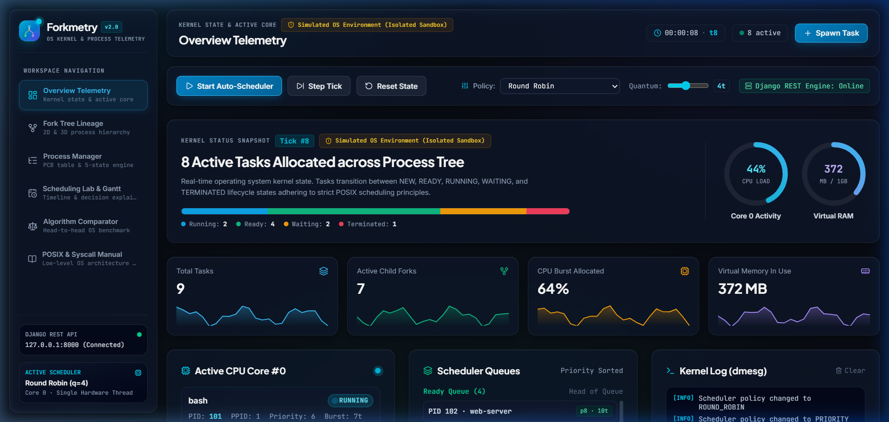
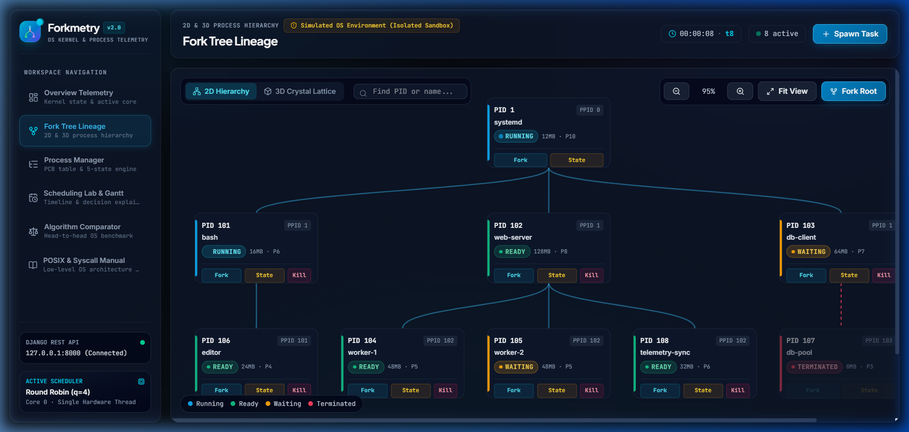
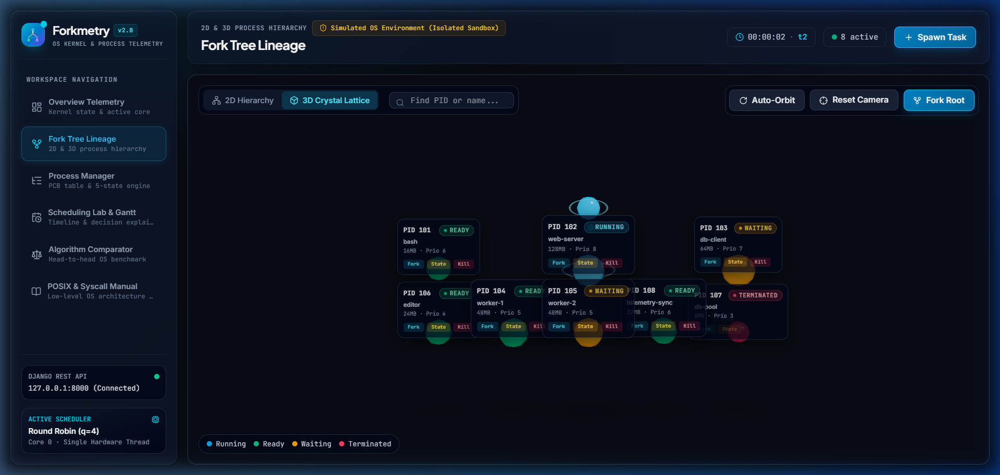
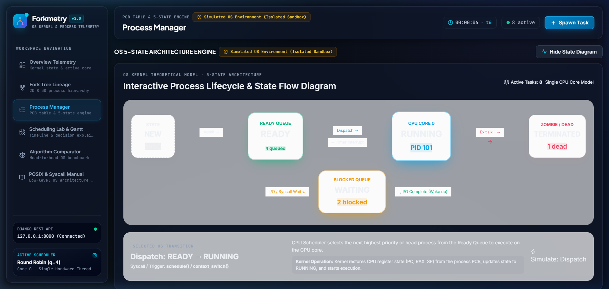
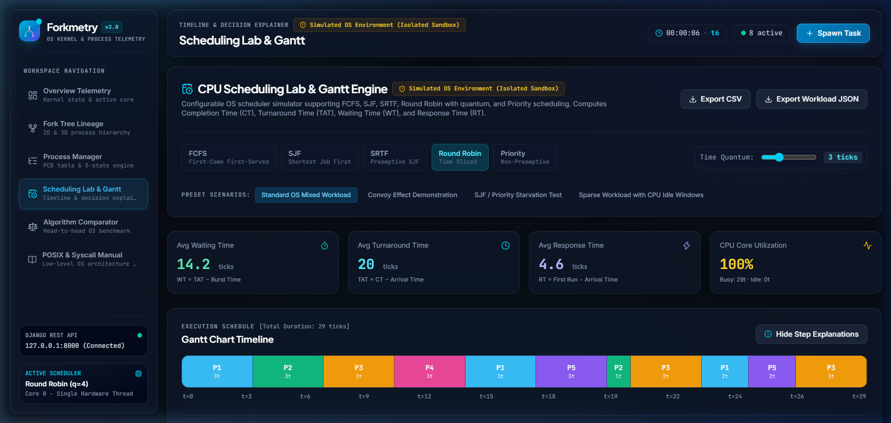
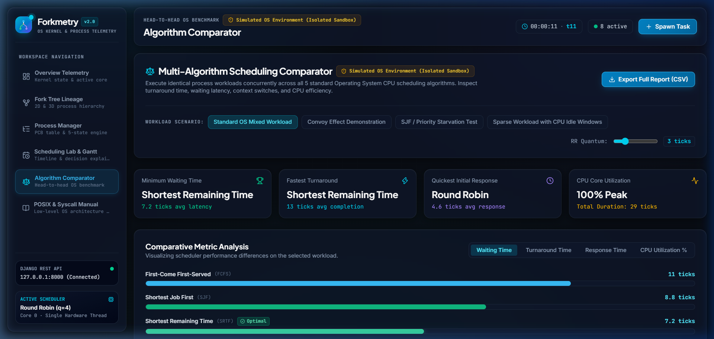
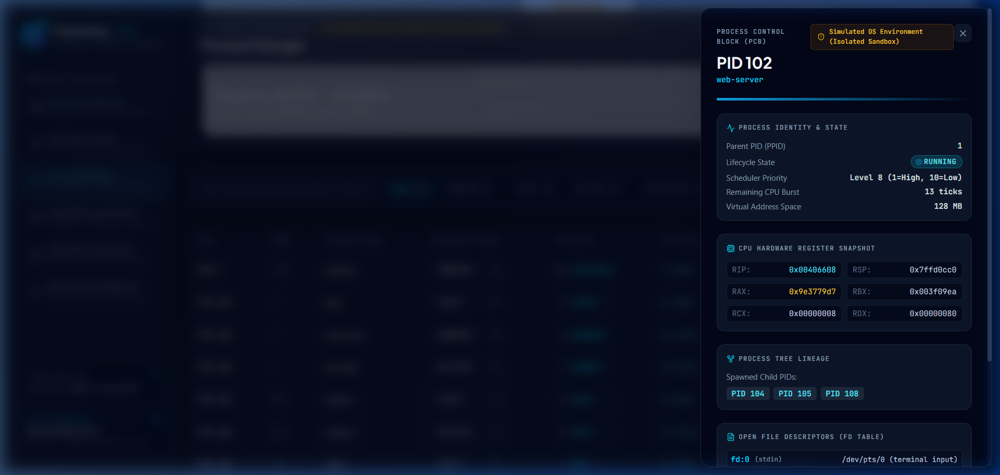
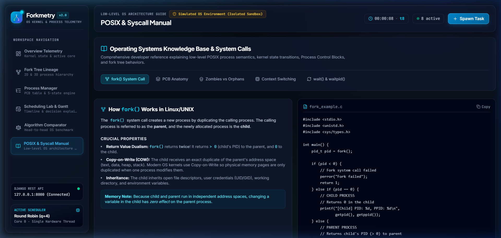
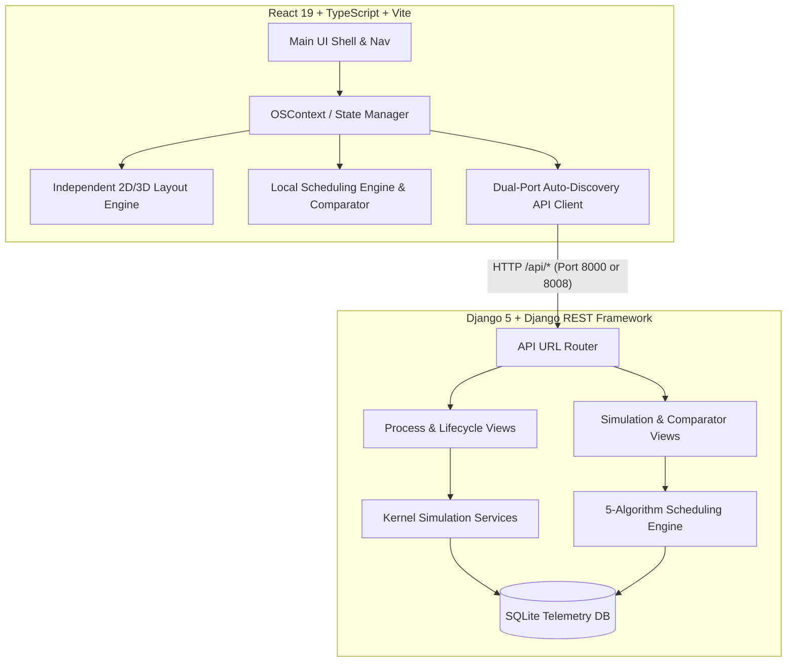

# Forkmetryqwertyu

### *Interactive Operating Systems Simulation & Process Visualization Platform*
> **Visualize Processes. Understand Execution.**

[](https://react.dev/)
[](https://www.typescriptlang.org/)
[](https://vitejs.dev/)
[](https://www.python.org/)
[](https://www.djangoproject.com/)
[](https://www.sqlite.org/)
[](https://threejs.org/)
[](LICENSE)
[-34d399.svg)](backend/api/tests.py)

**Forkmetry** is a full-stack, developer-grade Operating Systems educational simulation platform designed to demystify low-level process management, process ancestry, kernel lifecycle transitions, and CPU scheduling. Combining an interactive React + Three.js frontend with a Django REST API telemetry service, Forkmetry delivers intuitive, visual explanations of fundamental systems programming concepts.

---

## 📌 Project Overview

Operating Systems curricula and systems engineering fundamentals often rely on abstract diagrams and static terminal outputs, making it challenging for developers to grasp how kernels track processes, handle interrupts, and balance CPU workloads.

Forkmetry resolves this gap through real-time interactive simulation:
1. **Lineage Transparency:** Visualizes how `fork()` duplicates address spaces and builds tree hierarchies from PID 1 (`systemd`/`init`) down to leaf worker threads.
2. **State Transition Clarity:** Interactively simulates the canonical 5-state OS lifecycle (`READY`, `RUNNING`, `WAITING`, `TERMINATED`, `ZOMBIE`), showing how interrupts and signals mutate Process Control Blocks (PCBs).
3. **Deterministic Scheduling Analysis:** Simulates both non-preemptive and preemptive CPU scheduling algorithms tick-by-tick with Gantt charts, real-time metrics, step-by-step dispatch rationale, and head-to-head algorithm comparisons.

> ⚠️ **Simulated Kernel Notice:**  
> All kernel routines, CPU hardware registers (`RIP`, `RSP`, `RAX`, `RBX`, `RCX`, `RDX`), page allocations, and interrupt dispatches in Forkmetry operate within an isolated, user-space mathematical simulation designed for education, demonstration, and algorithm research.

---

## 🚀 Feature Showcase

- **Interactive 2D & 3D Process Tree Visualization:**
  - *2D Canvas Hierarchy:* Dynamic orthogonal and Bézier lineage branches with search, real-time node spotlighting, priority tags, and inline state controls.
  - *3D Crystal Lattice:* Interactive WebGL scene powered by Three.js (`@react-three/fiber` & `@react-three/drei`), rendering memory-proportional crystals, orbital halo rings for active cores, and 360° orbit camera controls.
- **Process Management & Inspection:**
  - Full PCB inspection drawer displaying virtual registers, process ancestry, and simulated file descriptors (`stdin`, `stdout`, `stderr`, network sockets, IPC pipes).
  - Process creation (`fork() + execve()`), runtime prioritization (1 = Highest to 10 = Lowest), state cycling, and `SIGTERM` signal delivery (with kernel protection preventing termination of PID 1).
- **5-State Process Lifecycle Engine:**
  - Interactive SVG diagram tracing OS state transitions: **Admit** (`fork`), **Dispatch** (`schedule`), **Preempt** (Timer IRQ), **I/O Wait** (`read`/`sleep`), **I/O Completion** (Hardware ISR), and **Exit** (`SIGTERM`).
  - Automated zombie reaping and orphan re-parenting to PID 1.
- **CPU Scheduling Laboratory:**
  - Step-by-step simulations for **FCFS** (First-Come First-Served), **SJF** (Shortest Job First), **SRTF** (Shortest Remaining Time First), **Round Robin** (with configurable time quantum), and **Priority Scheduling** (preemptive).
  - Interactive Gantt chart timeline with idle interval detection and task hover inspections.
  - Granular, step-by-step decision explainer logs stating exact kernel scheduling rationale for every CPU dispatch.
  - Workload scenario presets and CSV/JSON workload export.
- **Concurrent Algorithm Comparator:**
  - Runs all 5 algorithms simultaneously on identical workloads.
  - Leaderboard podium highlights optimal algorithms for Turnaround Time, Waiting Time, Response Time, and CPU Utilization.
- **POSIX & Syscall Developer Manual:**
  - In-app technical reference covering `fork()`, `execve()`, `waitpid()`, Copy-on-Write (COW), PCB anatomy, and IPC with copyable C code snippets.

---

## 📸 Screenshots & Visual Demonstrations

### 1. Overview Telemetry Dashboard
*Real-time kernel tick counter, active CPU Core #0 register monitor, memory usage gauge, and streaming kernel event console.*


### 2. Process Tree Lineage (2D & 3D Views)
*Interactive 2D process hierarchy with branch tracking and 3D crystal lattice WebGL rendering.*
| 2D Tree Hierarchy | 3D Crystal Lattice |
| :---: | :---: |
|  |  |

### 3. Process Manager & PCB Table
*Tabular Process Control Block manager with inline state controls, priority filters, and 5-state transition engine.*


### 4. CPU Scheduling Lab & Gantt Timeline
*Interactive Gantt timeline, step-by-step scheduler decision explainer, and customizable workload parameters.*


### 5. Multi-Algorithm Comparator
*Side-by-side shootout comparing FCFS, SJF, SRTF, Round Robin, and Priority on the exact same task set.*


### 6. PCB Hardware Register Inspector & POSIX Manual
*Deep inspection of simulated x86_64 registers and interactive POSIX system call documentation.*
| PCB Register Inspector | POSIX Syscall Manual |
| :---: | :---: |
|  |  |

---

## 🏗️ Architecture & Data Flow

Forkmetry uses a decoupled client-server architecture designed for zero-latency local experimentation and optional persistent backend synchronization:



### Architectural Highlights
- **Dual-Port Auto-Discovery:** [`src/services/api.ts`](src/services/api.ts) automatically tests port 8000 and gracefully falls back to port 8008, preventing common Windows `TIME_WAIT` socket collision issues.
- **Optimistic Local Simulation:** If the backend is offline, Forkmetry seamlessly falls back to its internal TypeScript scheduling and state engine, allowing full functionality even without an active Python environment.
- **Independent Layout Algorithms:** [`src/utils/treeLayout.ts`](src/utils/treeLayout.ts) computes hierarchical coordinates and bounding boxes without third-party layout libraries.

---

## 💻 Installation & Local Setup

### Prerequisites
- **Node.js:** v18.0.0 or higher (v20+ recommended)
- **Python:** v3.10, v3.11, or v3.12
- **Git**

---

### Windows (PowerShell) Setup

1. **Clone the repository:**
   ```powershell
   git clone https://github.com/Pranay-Kumar-02/forkmetry.git
   cd forkmetry
   ```

2. **Frontend Setup:**
   ```powershell
   npm install
   ```

3. **Backend Setup:**
   ```powershell
   # Create and activate Python virtual environment
   python -m venv backend/venv
   & "backend/venv/Scripts/Activate.ps1"

   # Install dependencies
   python -m pip install -r backend/requirements.txt

   # Run database migrations
   python backend/manage.py migrate
   ```

4. **Launch Development Servers:**
   - *Terminal 1 (Backend Server):*
     ```powershell
     & "backend/venv/Scripts/python.exe" backend/manage.py runserver 127.0.0.1:8008
     ```
   - *Terminal 2 (Frontend Server):*
     ```powershell
     npm run dev
     ```

5. **Open Application:**  
   Navigate to [http://localhost:5173](http://localhost:5173).

---

### macOS / Linux (Bash) Setup

1. **Clone and install frontend:**
   ```bash
   git clone https://github.com/Pranay-Kumar-02/forkmetry.git
   cd forkmetry
   npm install
   ```

2. **Set up Python backend:**
   ```bash
   python3 -m venv backend/venv
   source backend/venv/bin/activate
   pip install -r backend/requirements.txt
   python backend/manage.py migrate
   ```

3. **Run servers:**
   - *Terminal 1:*
     ```bash
     python backend/manage.py runserver 127.0.0.1:8008
     ```
   - *Terminal 2:*
     ```bash
     npm run dev
     ```

---

## 📖 Usage Guide & Scheduling Formulas

### 1. Spawning & Forking Processes
- Click **"Spawn Task"** in the top bar to simulate `fork() + execve()`.
- Specify process name, initial parent PID, priority (1–10), and expected CPU burst time.
- To fork from an existing process, hover over any node in the **Fork Tree** or **Process Table** and click the **Fork** button.

### 2. Process Lifecycle & Zombie Reaping
- Processes finish execution and enter the `TERMINATED` state once their remaining CPU burst reaches 0.
- Click **"Reap Terminated"** to simulate the parent calling `waitpid()`. Any orphaned child tasks are automatically re-parented to PID 1 (`systemd`).

### 3. CPU Scheduling Metrics & Formulas
Forkmetry implements exact discrete-time scheduling equations:

| Metric | Formula | Description |
| :--- | :--- | :--- |
| **Completion Time ($CT$)** | Time when process finishes execution | Absolute simulation tick when process remaining burst reaches 0. |
| **Turnaround Time ($TAT$)** | $TAT = CT - AT$ | Total time elapsed from arrival ($AT$) to completion ($CT$). |
| **Waiting Time ($WT$)** | $WT = TAT - BT$ | Total time process spent waiting in the Ready Queue ($BT$ = Burst Time). |
| **Response Time ($RT$)** | $RT = T_{\text{first\_run}} - AT$ | Time elapsed from arrival to the very first CPU execution tick. |
| **CPU Utilization** | $\frac{\text{Busy Ticks}}{\text{Total Simulation Time}} \times 100\%$ | Proportion of time CPU was actively executing processes vs. idling. |
| **Throughput** | $\frac{N_{\text{completed}}}{\text{Total Time}}$ | Number of processes completed per unit simulation time. |

---

## 🧪 Testing & Quality Checks

Forkmetry includes automated testing for both frontend bundling and backend scheduling correctness:

### 1. Backend Test Suite (21 Tests)
Validates mathematical correctness for scheduling algorithms, idle time intervals, preemption boundaries, multi-level orphan re-parenting, and REST endpoints:
```bash
# Windows
& "backend/venv/Scripts/python.exe" backend/manage.py test api

# Linux / macOS
python backend/manage.py test api
```
**Test Result:** `Ran 21 tests in 0.135s — OK (21/21 passed, 100% success rate)`.

### 2. Frontend Production Build
Validates TypeScript compilation, CSS token bundling, and module packaging:
```bash
npm run build
```
**Build Result:** `2516 modules transformed — built in ~24s with 0 errors`.

---

## ⚠️ Limitations & Future Development

1. **Educational Simulation Boundaries:** Forkmetry is a user-space discrete simulation. It models hardware registers, process lifecycles, and context switching for pedagogical observation; it does not execute binary machine code or bind directly to OS kernel syscalls.
2. **WebGL Tree Scale:** The 3D crystal lattice runs smoothly up to ~150 concurrent active processes before WebGL draw-call throttling occurs on lower-end GPUs.
3. **Planned Future Improvements:**
   - Multi-core CPU scheduling simulations (Core #0, Core #1, Core #2 affinity).
   - Multi-Level Feedback Queue (MLFQ) scheduling policy.
   - Virtual memory page-fault simulation and TLB cache hit/miss visualization.

---

## 📜 Project Details, Attribution & Provenance

- **Project Maintainer & Lead Developer:** **Pranay Kumar Vonamala** ([@Pranay-Kumar-02](https://github.com/Pranay-Kumar-02))
- **Reference Heritage:** Forkmetry is derived, expanded, and substantially re-architected from the reference repository [`fork-tree-visualizer`](https://github.com/ajiteshmohan/fork-tree-visualizer) by Ajitesh Mohan. Used with author permission for educational adaptation. Note that the upstream reference repository does not publish an explicit open-source license file in its root directory; downstream redistribution and sublicensing terms are detailed in [THIRD_PARTY_NOTICES.md](THIRD_PARTY_NOTICES.md).
- **Original Contributions in Forkmetry:**
  - Cyber-Slate Engineering Design System and interactive UI components.
  - Concurrent Multi-Algorithm Scheduling Comparator with automated leaderboard rankings.
  - Step-by-step scheduler decision explainer logs and workload export tools.
  - Independent 2D tree layout engine with subtree collision avoidance.
  - Dual-port fallback client (`8000`/`8008`) preventing local port conflicts.
  - Expanded 21-test automated backend test suite.

---

## ⚖️ License & Intellectual Property

- **Original Forkmetry Code & Documentation:** Copyright (c) 2026 Pranay Kumar Vonamala. Licensed under the [MIT License](LICENSE).
- **Reference Heritage & Retained Foundations:** Copyright (c) 2026 Ajitesh Mohan (`fork-tree-visualizer`). Used with permission. Note that upstream license formalization is required for unconditional public sublicensing.

For comprehensive component-level disclosures, dependency licenses, and legal notices, see:
- [LICENSE](LICENSE)
- [THIRD_PARTY_NOTICES.md](THIRD_PARTY_NOTICES.md)
